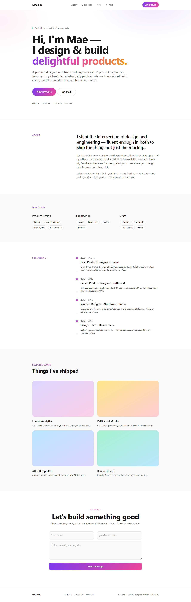

# Nama' Salameh — Portfolio & CV

A personal portfolio and CV built with **Next.js 15**, **Tailwind CSS v3**, and **TypeScript**.

**Live Demo:** [https://free-nextjs-cv-template.vercel.app](https://free-nextjs-cv-template.vercel.app)



[](https://vercel.com/new/clone?repository-url=https://github.com/cekuu35/free-nextjs-cv-template) &nbsp; [](https://free-nextjs-cv-template.vercel.app) &nbsp; [](./LICENSE)

> **Free & MIT-licensed.** Use it for your own portfolio, personal or commercial — no attribution required.
> Need a **business-site starting point**? **[Review all 20 verified demos](https://github.com/cekuu35/nextjs-website-templates#all-20-templates)** or **[get the current $79 bundle on Gumroad](https://cengokurtoglu.gumroad.com/l/vuhstz?wanted=true&utm_source=github&utm_medium=referral&utm_campaign=free_cv_template)**.

---

## Features

- **Pages** — Home, About, Portfolio, project details, and Contact
- **Centralized content** — update personal and portfolio content in `src/data/config.ts`
- **Dark mode** — switch themes from the navigation; the selection is remembered
- **Project pages** — project details are generated from the project data
- **Direct contact links** — email, phone, LinkedIn, and GitHub
- **SEO metadata** — page titles and descriptions
- **Responsive design** — layouts adapt to mobile and desktop screens
- **Accessible foundations** — semantic HTML and keyboard-friendly navigation

---

## Quick Start

### 1. Clone

```bash
git clone https://github.com/cekuu35/free-nextjs-cv-template.git my-portfolio
cd my-portfolio
```

### 2. Install

```bash
npm install
```

### 3. Develop

```bash
npm run dev
# Open http://localhost:3000
```

### 4. Deploy to Vercel

[](https://vercel.com/new/clone?repository-url=https://github.com/cekuu35/free-nextjs-cv-template)

Or push to GitHub and import in [vercel.com/new](https://vercel.com/new) — no extra configuration needed.

> Deployed? Before you share the link around, run the **[free 100-point website readiness scorecard](https://cekuu35.github.io/evidence-led-website-audit/scorecard.html?utm_source=github&utm_medium=readme&utm_campaign=aiweb_scorecard&utm_content=free_cv_template)** - no signup, nothing uploaded.

---

## Customize Your Content

Open `src/data/config.ts` and edit the exported constants:

| Constant | What it controls |
|---|---|
| `SITE` | Name, title, tagline, bio, email, location, availability badge |
| `NAV_LINKS` | Top navigation items |
| `SOCIAL_LINKS` | Social profile links |
| `SKILL_GROUPS` | Skill groups shown on the Home and About pages |
| `EXPERIENCE` | Work history |
| `EDUCATION` | Education history |
| `CERTIFICATIONS` | Certificates and image paths |
| `PROJECTS` | Project cards and detail pages |
| `TEMPLATE_BANNER` | Optional template banner |

Personal content and portfolio data are driven by this configuration. Page layouts and contact details can also be edited in `src/app`.

---

## Project Structure

```
src/
  app/
    page.tsx          # Home (hero + featured projects)
    about/            # About, experience, skills, education
    portfolio/        # Project grid + individual project pages
    contact/          # Contact details and social links
    layout.tsx        # Root layout — NavBar + Footer
  components/
    NavBar.tsx
    Footer.tsx
    SkillsExplorer.tsx
    ThemeToggle.tsx
  data/
    config.ts         # Site and portfolio content
```

---

## Tech Stack

| Layer | Choice |
|---|---|
| Framework | Next.js 15 (App Router) |
| Language | TypeScript 5 (strict) |
| Styling | Tailwind CSS v3 |
| Deployment | Vercel (one-click) |
| Node | 18+ |

---

## License

MIT — free for personal and commercial use. See [LICENSE](./LICENSE).

---

## Need a ready-made business site?

This template is a taste of the full collection. If you need an adaptable **business-site starting point for a real project** — not just a personal CV — check out the premium pack:

### 20 Next.js + Tailwind starter templates — current bundle price: $79

Includes complete, deployable sites for:

| # | Template | Type |
|---|---|---|
| 01 | Modern SaaS Landing | SaaS / startup |
| 02 | AI Startup | AI product landing |
| 03 | Digital Agency | Creative agency |
| 04 | Restaurant & Cafe | Food & beverage |
| 05 | Real Estate | Property listings |
| 06 | Fitness & Gym | Health & wellness |
| 07 | E-Commerce Store | Product / shop |
| 08 | Online Course | EdTech / creator |
| 09 | Dental Clinic | Medical / local service |
| 10 | Restaurant Reservation | Booking-focused food |
| 11 | Barber & Salon | Local service |
| 12 | Photography Portfolio | Creative portfolio |
| 13 | Event & Conference | Events / ticketing |
| 14 | Web3 & Crypto | Blockchain / DeFi |
| 15 | Mobile App Landing | App marketing |
| 16 | Newsletter & Creator | Content creator |
| 17 | Hotel Booking | Hospitality |
| 18 | Construction Company | Trade / B2B |
| 19 | Law Firm | Professional services |
| 20 | Personal CV (this one) | Personal / freelance |

The separate bundle contains 20 responsive TypeScript, App Router, and Tailwind CSS starter sites. Review the checkout and included README files for the exact delivered versions, license scope, and integration requirements.

**[Review the clean $79 bundle page](https://cekuu35.github.io/nextjs-template-bundle/)** · **[Get the current $79 bundle on Gumroad](https://cengokurtoglu.gumroad.com/l/vuhstz?wanted=true&utm_source=github&utm_medium=referral&utm_campaign=free_cv_template)**

Full showcase with live demos for all 20 templates:  
**[github.com/cekuu35/nextjs-website-templates](https://github.com/cekuu35/nextjs-website-templates)**

Questions? Open an issue or reach out via the site.
